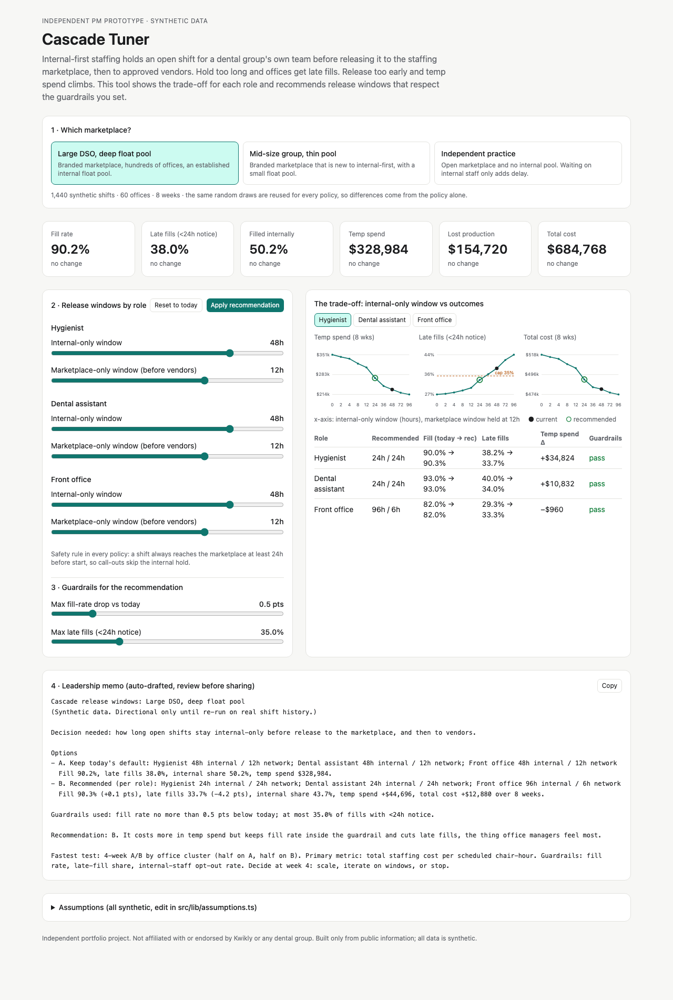

# Cascade Tuner

**How long should a dental group hold an open shift for its own staff before sending it to the staffing marketplace?**

Internal-first staffing (a group's own team gets first pick, then the marketplace, then approved vendors) is a strong idea, but the release window is a hidden pricing decision:

- **Hold too long** → offices get late confirmations (<24h notice) and more chairs go unfilled.
- **Release too early** → the marketplace fills shifts your own team would have taken, and temp spend rises.
- **One default doesn't fit every marketplace**: a large DSO with a deep float pool, a group new to internal-first, and an independent practice with no pool need very different windows.

Cascade Tuner simulates the trade-off for each role, recommends windows inside the guardrails you set, and drafts the options memo for leadership.



> Independent portfolio project by Manish Katheeth. Not affiliated with or endorsed by Kwikly or any dental group. Built only from public information. **All data is synthetic**, and "today's default" (48h internal / 12h marketplace) is illustrative, not a known setting.

## What it shows (synthetic large-DSO profile, 1,440 shifts, 8 weeks)

| | Today (48h for every role) | Recommended per role |
|---|---|---|
| Fill rate | 90.2% | 90.3% |
| Late fills (<24h notice) | 38.0% | **33.7%** |
| Filled internally | 50.2% | 43.7% |
| Temp spend | $329k | +$44.7k |

The recommendation isn't free. It buys a 4.3-pt cut in late fills for about $45k of extra temp spend over 8 weeks. The tool's job is to make that a priced, explicit choice. Switch to **Independent practice** and the answer flips: any internal hold is pure delay, so the recommendation is 0h, late fills drop 20 pts and total cost goes down.

## Run it
```bash
npm install
npm run dev      # http://localhost:3000
npm test         # 13 engine tests: determinism, monotonic trade-off, guardrails
npm run build
```

## How it works
- `src/lib/assumptions.ts` holds every synthetic number (bill rates, claim speed, availability, lead-time mix, marketplace profiles) in one file, so it can be swapped for real data.
- `src/lib/sim.ts` generates shifts with a seeded RNG and simulates internal → marketplace → vendor claims. Every policy sees the **same random draws** (common random numbers), so differences come only from the policy. It then grid-searches windows per role to minimize total cost (internal labor + temp spend + lost production) under two guardrails: max fill-rate drop vs today, and max late-fill share.
- Safety rule: every shift reaches the marketplace ≥24h before start, so call-outs skip the hold.
- `src/lib/memo.ts` drafts a short A/B/C options memo with a 4-week test plan.

## PM docs
- [PRD](docs/PRD.md): users, what they should be able to do, acceptance criteria, edge cases, launch plan
- [Metrics](docs/metrics.md): north star, guardrails, instrumentation, SQL, decision rule
- [Teardown](docs/teardown.md): public research behind the problem
- [Roadmap](docs/roadmap.md)

## Trade-offs I made
- **Simulation, not ML.** Exponential claim curves are crude, but they're explainable to an ops lead and easy to calibrate from one SQL pull. Model quality comes after the decision framing is right.
- **Per role, not per office.** That's enough to show "one default doesn't fit", and it doesn't overfit thin office-level data.
- **Recommend, never auto-apply.** Changes go out as a 4-week A/B by office cluster with a stop rule.

## What I'd do next
Calibrate on 8 weeks of real shift history, backtest last quarter, then pilot with one group. See the [roadmap](docs/roadmap.md).
